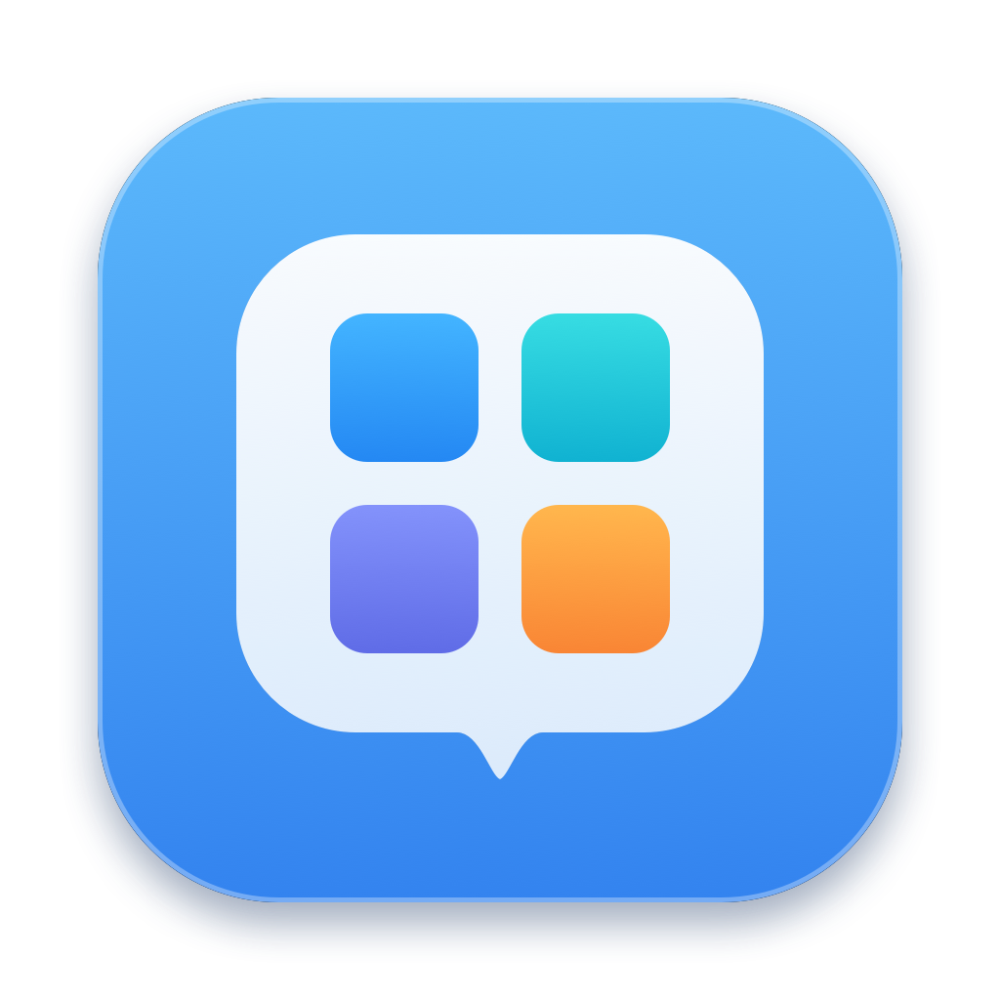

# ChestDock 🗂️

> 专为 macOS 设计的极简、轻量级 iOS 风格 Dock 应用文件夹与悬浮抽屉。

<p align="center">
  
</p>

<p align="center">
  <a href="https://github.com/Minato-chen/ChestDock/releases"></a>
  
  
  <a href="LICENSE"></a>
</p>

---

## ✨ 核心特性

- 📱 **iOS 风格文件夹**：点击 Dock 图标在正上方弹出带自适应小尾巴的毛玻璃悬浮气泡，点完应用自动收起，零打扰。
- 📑 **顶部分类与翻页网格**：支持顶部分类标签切换（如“常用”、“开发”、“创作”），每个分类支持触控板双指左右滑动或鼠标翻页。
- 📌 **钉住（Pin）与工作台拖拽**：一键钉住面板，支持按住顶部横条拖到屏幕任意位置；拖离后小尾巴自动平滑收缩为悬浮窗。
- ↘↖ **收起为悬浮球 (Collapse)**：钉住后可一键将面板缩小为极简 `48×48` 悬浮小球，临时腾出桌面空间，单击立即就地展开。
- 🌐 **Dock 与菜单栏双入口瞬切**：支持屏幕顶部菜单栏入口，点击即在菜单栏下方弹出朝下小尾巴；在 Dock 与菜单栏之间点击可瞬时无缝切换位置。
- 🎨 **自由定制网格**：自由调节 `2~6` 行 × `3~8` 列以及图标大小，气泡自适应平滑缩放。
- 🚀 **原生极速与极低资源占用**：纯 Swift / SwiftUI / AppKit 打造，常驻后台内存仅约 20~30MB，无 Electron 臃肿负担。

---

## ⌨️ 快捷键速查

| 快捷键 | 功能描述 |
| :--- | :--- |
| **`Esc`** | 立即收起并关闭面板 |
| **`⌘P`** (可自定义) | 钉住 / 取消钉住气泡面板 |
| **`⌘M` / `⌘-`** (可自定义) | 钉住状态下：缩小为悬浮球 / 展开 |
| **双击顶部胶囊横条** | 钉住状态下：快速收起为悬浮球 |
| **`←` / `→`** | 分类内翻页 |
| **`⌘ + ←` / `⌘ + →`** | 切换上一个 / 下一个分类 |
| **`Tab` / `⇧ + Tab`** | 循环正向 / 逆向切换分类 |
| **`⌘ + 点击应用`** | 启动目标应用并保持面板展开（连开模式） |

---

## 📥 安装与运行

### 方式 1：下载预编译 DMG（推荐）
1. 从 [Releases](https://github.com/Minato-chen/ChestDock/releases) 页面下载最新的 `ChestDock-1.1.1.dmg`。
2. 双击打开，将 `ChestDock.app` 拖入 `Applications`（应用程序文件夹）即可。
3. **首次打开提示**：由于个人独立开发者证书未进行公证，首次打开时若提示“无法验证开发者”，请在 Finder 中对 `ChestDock.app` **右键 -> 打开** 即可正常启动。

### 方式 2：从源码编译
```bash
git clone https://github.com/Minato-chen/ChestDock.git
cd ChestDock
# 使用 Xcode 打开调试运行
open ChestDock.xcodeproj
```

---

## 🛠️ 设置与自定义

- 按 **`⌘,`** 或在 Dock / 菜单栏图标上右键选择 **「设置...」**。
- **通用**：开启开机自动启动、自动检查更新、菜单栏图标开关。
- **分类与应用**：自由增删分类、重命名、拖拽排序、批量添加应用。
- **网格与外观**：滑动调整行数、列数、图标尺寸、Dock 缩略图模式。
- **快捷键**：自定义钉住与折叠快捷键。
- **扩展与权限**：可按需开启辅助功能精确定位，预留了常用文件夹/文件添加支持。

---

## 📄 开源许可

本项目遵循 [MIT License](LICENSE) 开源协议。
