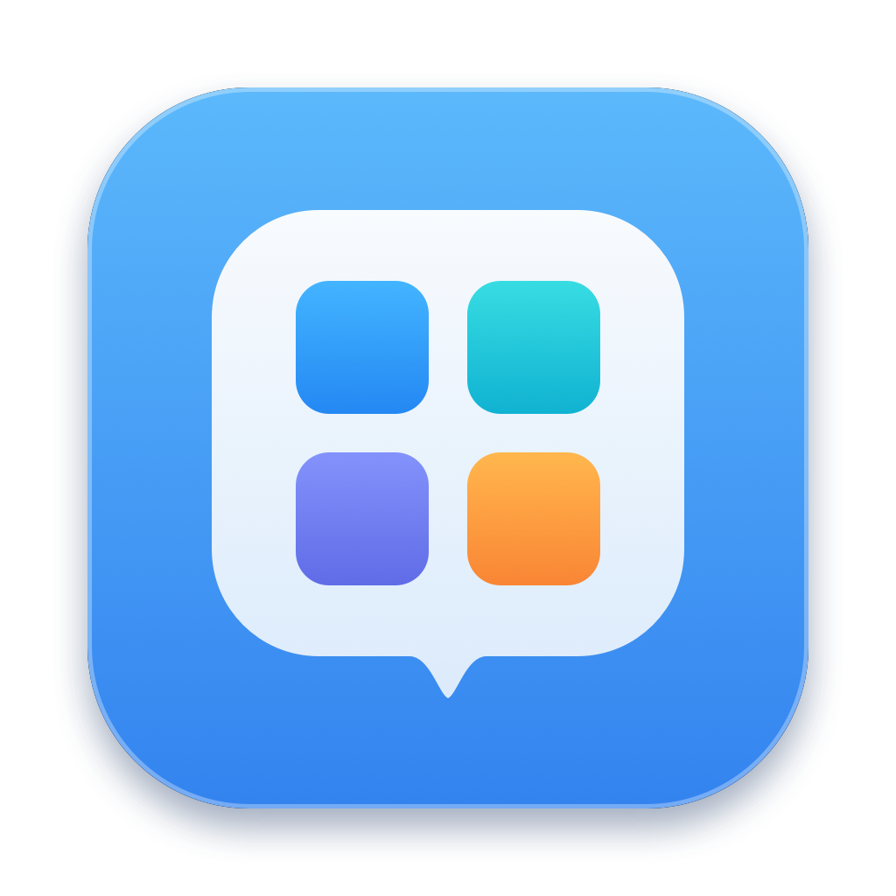
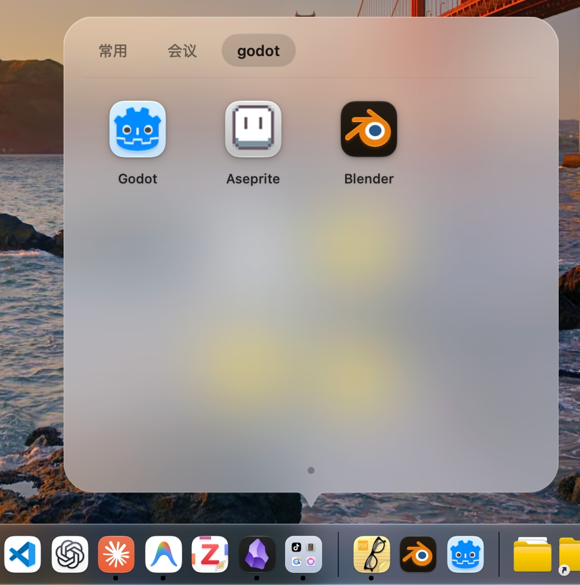

<div align="center">



<h1>ChestDock</h1>

<p><strong>Bring iOS-style paginated folders to your macOS Dock.</strong></p>
<p>A lightweight, native Swift popover launcher with category tabs, customizable grids, and a pinnable floating drawer — no bloated Launchpad clones.</p>

<p>
  <a href="https://github.com/Minato-chen/ChestDock/releases/latest"></a>
  
  
  <a href="LICENSE"></a>
</p>

<p>
  <a href="#installation">Download</a> ·
  <a href="#features">Features</a> ·
  <a href="#shortcuts--gestures">Shortcuts</a> ·
  <a href="#privacy--permissions">Privacy</a> ·
  <a href="README_zh.md">简体中文</a>
</p>

<br />



</div>

---

## Features

- **iOS-Style Paginated Popover** — Click the Dock icon to open a frosted-glass bubble with an adaptive pointer tail. Switch category tabs on top and swipe horizontally via trackpad or scroll wheel. Launching an app dismisses the bubble automatically, or hold `⌘` / `⌥` while clicking to keep it open.
- **Pin, Detach & Collapse** — Pin the popover to keep it on screen and drag it anywhere; the pointer tail smoothly retracts when detached. Collapse a pinned panel into a `38×38` floating pill (via shortcut, context menu, or optional double-click top handle) and click to expand in place.
- **Dock & Menu Bar Dual Entry** — Automatically adapts to Bottom, Left, or Right Dock positions, with an optional Menu Bar icon for instant top-down access.
- **Customizable Grid & Live Dock Icon** — Configure `1–5` rows × `1–9` columns and `36–96 pt` icon sizes. Display a `2×2` or `3×3` live mini-grid preview on the Dock icon (optionally synced to the active category), or use the static app icon. Drag and drop apps directly onto the bubble to add them.
- **Native SwiftUI & AppKit** — Built strictly with native macOS frameworks (`Swift 5.9`, `SwiftUI`, `AppKit`) with zero Electron overhead.

---

## Installation

1. Download the latest `.dmg` from [**GitHub Releases**](https://github.com/Minato-chen/ChestDock/releases/latest).
2. Open the disk image and drag **ChestDock.app** into your **Applications** folder.

<details>
<summary>First launch note (unnotarized personal build)</summary>

ChestDock is signed ad-hoc without an Apple Developer notarization certificate. On first launch, if macOS displays *"ChestDock cannot be opened because the developer cannot be verified"*:

1. Locate `ChestDock.app` in **Applications**, **Right-click (or `⌃` + Click) → Open**, then confirm **Open**; or
2. Open **System Settings → Privacy & Security** and click **Open Anyway**.

</details>

---

## Shortcuts & Gestures

<details>
<summary>View all keyboard shortcuts and mouse gestures</summary>

| Input | Action | Notes |
| :--- | :--- | :--- |
| `Esc` | Close popover | Works even when pinned |
| `←` / `→` | Previous / Next page | Also supports horizontal trackpad swipe / scroll wheel |
| `⌘ + ←` / `⌘ + →` (or `⌥`) | Previous / Next category | — |
| `Tab` / `⇧ + Tab` | Cycle categories forward / backward | — |
| `⌘ + Click` or `⌥ + Click` | Launch app without closing popover | Multi-launch mode |
| `⌘,` | Open Settings | Also available via Right-click menu |
| Pin shortcut (e.g. `⌘P`) | Pin / Unpin popover | Disabled by default; enable & customize in Settings |
| Collapse shortcut (e.g. `⌘M`) | Collapse / Expand pinned popover | Disabled by default; enable & customize in Settings |
| Double-click top pill handle | Collapse pinned popover | Requires floating handle enabled in Settings |

</details>

<details>
<summary>Settings & Customization overview</summary>

- **General**: Launch at login (`SMAppService`), automatic update check, Menu Bar icon toggle.
- **Categories & Apps**: Create, rename, reorder, and delete categories; batch-add apps or drag & drop directly onto the bubble; optional support for folders and files.
- **Grid & Appearance**: Adjust rows (`1–5`), columns (`1–9`), icon size (`36–96 pt`), running-app indicator dots, and Dock tile preview mode (`Static` / `2×2` / `3×3`).
- **Shortcuts & Floating**: Configure optional Pin/Collapse hotkeys and floating handle behavior.

</details>

---

## Privacy & Permissions

ChestDock is designed to run locally on your Mac with zero telemetry:

- **No Analytics or Tracking**: ChestDock collects no usage data, crash telemetry, or personal information.
- **Local-Only Storage**: Categories, layout preferences, and app references are saved locally at `~/Library/Application Support/ChestDock/state.json`.
- **Single Optional Network Call**: Only `UpdateChecker` queries `https://api.github.com/repos/Minato-chen/ChestDock/releases/latest` to check for new versions, and can be disabled in Settings.
- **Optional Accessibility Permission**: Used solely to read the exact coordinates of ChestDock's Dock icon (`com.apple.dock`) so the popover tail aligns precisely. ChestDock works normally without granting Accessibility by falling back to cursor-position estimation.

---

## Build from Source

<details>
<summary>Requirements & Xcode build steps</summary>

- macOS 14.0+ and Xcode 16.0+ (Swift 5.9)

```bash
git clone https://github.com/Minato-chen/ChestDock.git
cd ChestDock
open ChestDock.xcodeproj
```

> If you modify project structure via `project.yml`, regenerate the project with [XcodeGen](https://github.com/yonaskolb/XcodeGen) (`xcodegen generate`).

</details>

---

## License

Released under the [MIT License](LICENSE).
