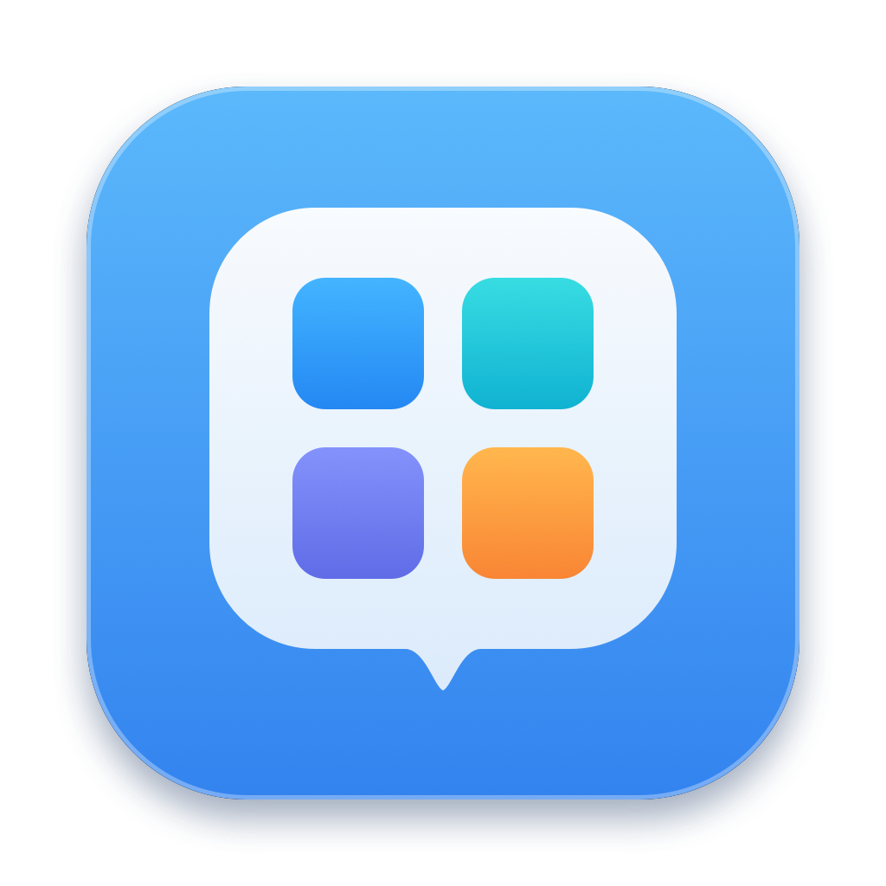
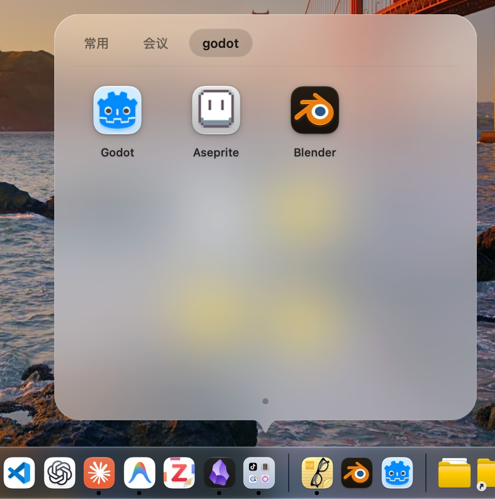

<div align="center">



<h1>ChestDock</h1>

<p><strong>把 iPhone 文件夹搬进 macOS Dock 栏。</strong></p>
<p>专为 macOS 打造的原生轻量 Dock 悬浮收纳抽屉：支持分类标签、横向翻页、自定义网格尺寸与桌面悬浮球。</p>

<p>
  <a href="https://github.com/Minato-chen/ChestDock/releases/latest"></a>
  
  
  <a href="LICENSE"></a>
</p>

<p>
  <a href="#安装方式">下载安装</a> ·
  <a href="#核心特性">核心特性</a> ·
  <a href="#快捷键与手势">快捷键</a> ·
  <a href="#隐私与权限">隐私与权限</a> ·
  <a href="README.md">English</a>
</p>

<br />



</div>

---

## 核心特性

- **iPhone 风格分页弹窗** — 点击 Dock 图标弹出带自适应小尾巴的毛玻璃气泡，顶部切换分类标签，支持触控板横向滑动与滚轮翻页；点开应用自动收起，按住 `⌘` 或 `⌥` 点击可连开不关闭。
- **钉住、拖拽与悬浮球** — 一键钉住（Pin）保持常驻并自由拖到屏幕任意位置，拖离 Dock 后小尾巴平滑收缩；支持收起为极简 `38×38` 悬浮小球（通过快捷键、右键菜单或可选双击顶部胶囊条），单击原地展开。
- **Dock 与菜单栏双入口** — 自适应 Dock 在底部、左侧或右侧的位置，同时支持顶部菜单栏入口瞬时切换呼出。
- **自定义网格与动态 Dock 图标** — 支持自由调节 `1~5` 行 × `1~9` 列与 `36~96 pt` 图标尺寸；Dock 图标可设为 `2×2` / `3×3` 动态缩略图预览（支持随当前分类同步）或静态图标，并支持直接拖拽应用到气泡内添加。
- **纯原生技术栈** — 基于 `Swift 5.9`、`SwiftUI` 与 `AppKit` 开发，无 Electron 臃肿依赖。

---

## 安装方式

1. 前往 [**GitHub Releases**](https://github.com/Minato-chen/ChestDock/releases/latest) 下载最新的 `.dmg` 安装包。
2. 双击打开磁盘映像，将 **ChestDock.app** 拖入 **Applications（应用程序）** 文件夹即可。

<details>
<summary>首次打开提示“无法验证开发者”的解决方法</summary>

由于个人开发者构建未经过 Apple 公证，首次启动若系统拦截：

1. 在 **应用程序** 中对 `ChestDock.app` **右键（或 `⌃` + 左键）→ 打开**，并在弹窗中确认打开；或
2. 打开 **系统设置 → 隐私与安全性**，点击 **仍要打开**。

</details>

---

## 快捷键与手势

<details>
<summary>展开查看完整快捷键与交互手势</summary>

| 操作 | 功能说明 | 备注 |
| :--- | :--- | :--- |
| `Esc` | 关闭悬浮面板 | 钉住状态下同样有效 |
| `←` / `→` | 上一页 / 下一页 | 也支持触控板左右滑动或鼠标横向滚动 |
| `⌘ + ←` / `⌘ + →`（或 `⌥`） | 上一个 / 下一个分类 | — |
| `Tab` / `⇧ + Tab` | 正向 / 逆向循环切换分类 | — |
| `⌘ + 点击` 或 `⌥ + 点击` | 启动应用并保持面板不收起 | 适合连续启动多个应用 |
| `⌘,` | 打开设置窗口 | 也可通过右键菜单进入 |
| 钉住快捷键（如 `⌘P`） | 钉住 / 取消钉住面板 | 默认关闭，可在设置中启用并自定义 |
| 收起快捷键（如 `⌘M`） | 钉住状态下折叠为悬浮球 / 展开 | 默认关闭，可在设置中启用并自定义 |
| 双击顶部胶囊横条 | 钉住状态下折叠为悬浮球 | 需在设置中开启悬浮触发条 |

</details>

<details>
<summary>设置与自定义选项一览</summary>

- **通用**：开机自启（基于系统原生 `SMAppService`）、自动检查更新、菜单栏图标开关。
- **分类与应用**：自由增删分类、重命名与拖拽排序；支持批量添加或直接拖入气泡，并可按需开启文件夹与文件添加支持。
- **网格与外观**：调节网格行数（`1~5`）、列数（`1~9`）、图标大小（`36~96 pt`）、运行中指示点与 Dock 图标预览样式（静态 / `2×2` / `3×3`）。
- **快捷键与悬浮**：启用并自定义钉住、收起快捷键及悬浮条交互。

</details>

---

## 隐私与权限

ChestDock 坚持纯本地运行与零遥测原则：

- **无任何统计与追踪**：不收集使用数据、崩溃日志或任何个人信息。
- **纯本地持久化**：分类、应用列表与外观配置仅保存于本地 `~/Library/Application Support/ChestDock/state.json`。
- **唯一可选网络请求**：仅更新检查模块会请求 `https://api.github.com/repos/Minato-chen/ChestDock/releases/latest` 获取最新版本信息，可在设置中关闭自动检查。
- **辅助功能权限完全可选**：仅用于读取 `com.apple.dock` 中 ChestDock 图标的精确坐标以对齐气泡小尾巴；不授权也可通过鼠标位置估算正常使用。

---

## 从源码构建

<details>
<summary>环境要求与 Xcode 编译步骤</summary>

- macOS 14.0+ 与 Xcode 16.0+（Swift 5.9）

```bash
git clone https://github.com/Minato-chen/ChestDock.git
cd ChestDock
open ChestDock.xcodeproj
```

> 如需根据 `project.yml` 重新生成工程文件，可使用 [XcodeGen](https://github.com/yonaskolb/XcodeGen) 执行 `xcodegen generate`。

</details>

---

## 开源许可

本项目基于 [MIT License](LICENSE) 开源。
